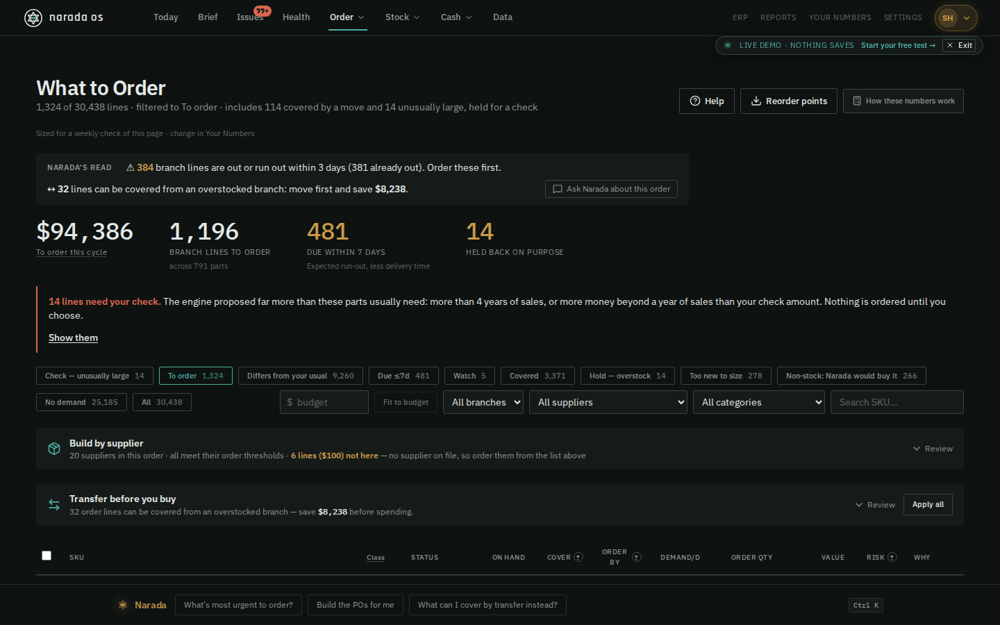
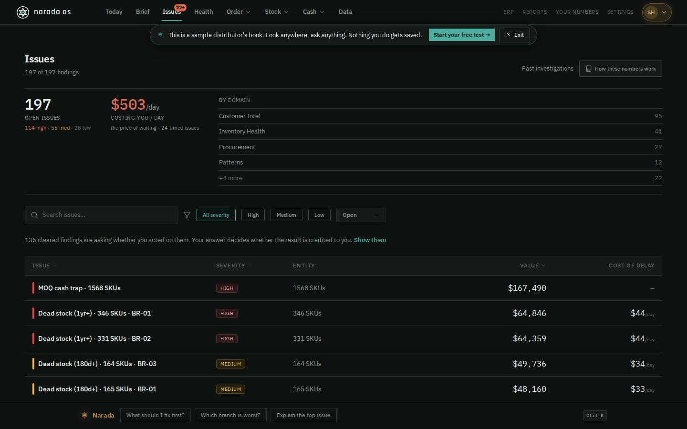

# Straight Answer Agent

### Never let an AI agent guess with your numbers.

Everyone's building "AI agents" right now. The question that actually decides whether a business hires one is
whether it'll invent a figure in front of a customer, or take an action nobody approved. This one gives you a
straight answer instead: ask it anything about your operation in plain English, and it answers from real,
verified lookups — never a guess, and "I don't know" when that's the honest answer. When it can draft something
for you (a purchase order, a supplier email, a config change), the draft *is* its answer — it writes it and
waits for a human to approve before anything goes out. Nothing executes on its own.

This is the real architecture behind [Narada OS](https://naradaos.com), the AI operating system for stock-holding
distributors I built solo. The video below is the actual product, running on its own public sample-data demo —
not a mockup.

<video controls preload="metadata" poster="assets/issues.png" style="width:100%;border-radius:10px;border:1px solid #e5e7eb;display:block">
<source src="assets/demo.mp4" type="video/mp4">
Your browser doesn't support embedded video — <a href="assets/demo.mp4">download the clip</a> instead.
</video>

2 minutes, the real product, sample distributor data — the same build described on this page.

## What it actually does

<b>Proposes, never executes.</b> "14 lines need your check. The engine proposed far more than these parts
usually need... Nothing is ordered until you choose." The agent can build every PO on this page — a human still
approves each one.

<b>Works while nobody's asking.</b> It runs its own investigations overnight — connecting a margin drop to a
supplier, a dead-stock pile to a minimum-order quantity — and leaves a written memo with every number traceable
back to where it came from, ready to review in the morning.

## Why this is different from "a chatbot on your data"

The tool registry behind this is 42 tools deep. 34 of them only ever read and report verified numbers. The
other 8 can only <b>propose</b> — a purchase order, an email, a config change — never send or execute anything by
themselves. A human approves every single one.

Most "chat with your data" demos are impressive right up until someone asks a question the model can't actually
answer — and it answers anyway, convincingly, with a number it invented. That's not a hypothetical; it's the
default failure mode of bolting a chatbot onto a spreadsheet. Two things make this one different:

- **It can't show you a number it didn't verify.** Every figure the agent states comes from a tool that actually
  queried the data — never from the model's own reasoning about what the answer "should" be. If a tool can't
  verify something, the agent says so instead of guessing.
- **It can't act without you.** Drafting a purchase order or a supplier email is one thing; sending it is
  another. The line between those two is enforced in code, not left to the model's good judgment — every write
  is a proposal sitting in front of a human until they approve it.

---

Curious how the trust layer actually works? See [how it works](how-it-works.md).

The video and screenshots above are Narada OS's own public demo mode, which runs on an invented "sample
distributor's book" — not a real client's data. Narada OS has no paying customers; this page describes
architecture I built and ran, not a product currently live for anyone else to use. The production source is
proprietary and isn't published here — this page and the next describe how it works, not the code itself.

